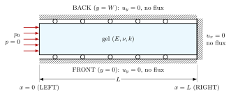

# Terzaghi consolidation, nondimensionalised

Two ways of solving a poromechanics problem in dimensionless variables, on the case that has an exact
solution: Terzaghi's 1D consolidation. Same case as fenicsoft `demos/analytical_consolidation_1D`
(rectangle $100 \times 10\ \mu\text{m}$, St Venant–Kirchhoff skeleton $E = 5$ kPa, $\nu = 0.4$,
$k = 1.8\cdot10^{-13}$ m²/(Pa·s), load $p_0 = 100$ Pa), so that a diff with the SI demo shows exactly what the
nondimensionalisation adds. One difference: Darcy uses the pulled-back conductivity
$\mathbf K_L = k\,J\mathbf C^{-1}$ (`hill_playground.materials.permeability.constant`) instead of a constant $k\mathbf I$. In each `main.py`, every such line is tagged `# NONDIM`.



| Folder | Method | Steps |
| --- | --- | --- |
| `nondim_parameters/` | coefficients divided by their scales, weak form unchanged, time $\hat t = t/t_0$ | one step |
| `nondim_operator/` | coefficients and time in SI, each term multiplied by a `scale_factor` | initialising step ($10^{-6}$ s, drained face $p_0 \to 0$) + consolidation |

Shared files: `terzaghi_analytics.py` (exact pressure and settlement, numpy) and `post_process.py` (QOIs,
errors, figure).

## Run

```bash
cd demos/analytical_consolidation_1D/nondim_parameters   # or nondim_operator
python3 main.py
```

Outputs in `outputs/` next to `main.py`: mesh, results (`results/*.xdmf` for ParaView, `*-qois.dat`), and in
`images/`:

- `terzaghi.png`: pressure profiles at $T = 0.02 \dots 1$ (lines Terzaghi, markers FE), settlement of the loaded
  face, errors vs time;
- `errors.csv`: $e_p(t)$ (RMS pressure error on 21 probes, relative to $p_0$) and $e_u(t)$ (settlement error,
  relative to $u_\infty = p_0 L/M$).

`main()` returns the errors, and the console prints their maximum over $T \ge 0.05$.

## The recipe, in short

Scales: $L_0 = L$, $\mu_0 = M$ (oedometric modulus), $t_0 = L^2/c_v$ with $c_v = kM$, so that $\hat t$ is
Terzaghi's time factor $T$.

| Step | `nondim_parameters` | `nondim_operator` |
| --- | --- | --- |
| mesh | $\hat{\mathbf X} = \mathbf X/L_0$ | same |
| unknowns | $\hat{\mathbf u} = \mathbf u/L_0$ (automatic), $\hat p = p/\mu_0$ | same |
| coefficients | $\hat E = E/\mu_0$, $\hat k = k\mu_0 t_0/L_0^2$, $\hat p_0 = p_0/\mu_0$ | SI |
| time | $\hat t = t/t_0$ | SI |
| weak form | unchanged, every `scale_factor` = 1 | `scale_factor` per term: skeleton $1/\mu_0$, fluid stress 1, load $1/\mu_0$, $\dot J$ $t_0$, Darcy $\mu_0 t_0/L_0^2$ |
| outputs | QOIs × scales, XDMF geometry and time back to SI | QOIs × scales, XDMF geometry back to SI |

Both give the same dimensionless system, hence the same solution (same errors below). Use the parameters
when you own the whole model; use the operators when coefficients or time must stay in SI (shared laws,
loads or activations given in seconds). The `scale_factor` of a term follows from three numbers per row,
handled by `hill_playground.operators.ResidualRows`: see the docstring of `nondim_operator/main.py`.

## Expected errors

With the defaults (both demos, 21 probes, $T \ge 0.05$; measured with $k\mathbf I$, to update with $\mathbf K_L$): pressure $2.4\cdot10^{-2}\,p_0$, settlement
$1.4\cdot10^{-2}\,u_\infty$. Two causes, neither the scaling:

- the settlement error is the finite-strain effect: Terzaghi is linear, the FE model is not, and
  $p_0/M \approx 1\,\%$;
- the pressure error comes from the first time steps ($\Delta t = 0.1$ s, i.e. $\Delta T \approx 0.02$),
  too coarse for the boundary layer at the drained face.

With $p_0 = 1$ Pa and $\Delta t = 0.01$ s: $2.7\cdot10^{-3}$ and $1.2\cdot10^{-3}$.

## To adapt to your own model

1. Choose $L_0$, $\mu_0$, $t_0$ (`CharacteristicScales`): a length of the geometry, the stiffness that
   carries the load, the time of the slowest process you want to resolve.
2. Divide the mesh coordinates by $L_0$ right after loading the mesh; give probe points in mesh coordinates.
3. Give each unknown its scale ($\hat p = p/\mu_0$, initial values and Dirichlet values included).
4. Either convert every coefficient (`CharacteristicScales.nondimensionalize_*`) or give every operator its
   `scale_factor` (`ResidualRows`).
5. Redimensionalise what you export (`redimensionalize_*` in the QOI expressions,
   `hill_playground.io.xdmf_units` for the XDMF).
6. Check against an SI run, or against an exact solution as here.
