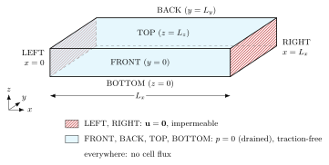

# Hill box (uniaxial)

Active poro-elastic gel slab $875 \times 375 \times 50\ \mu\text{m}$ seeded with contractile cells
(Hill chain) of random isotropic orientation. The slab is clamped on its two $x$-faces, drained
($p = 0$) and traction-free on the four others. Under the activation $\alpha(t)$ (ramp 0 → 1, then hold)
the cells contract, the gel shortens across $x$ and expels liquid; the cells may also migrate,
proliferate and reorient.

<p align="center">
  
</p>

Unknowns: displacement $\mathbf u$, liquid pressure $p$, CE log-stretch $\varepsilon_a$, and optionally
the cell fraction $\Phi_c$ with the smoothed substrate fraction $\tilde\phi_s$ (`cell_transport`) and the
cell orientation angles $\theta, \varphi$ (`remodelling`). Residuals: module docstring of `hill_box_uniaxial.py`.

| Item | Where |
| --- | --- |
| Hill law ($R_u$), activation $\alpha(t)$ | `materials.cell.active.hill`, `materials.cell.active.activation` |
| CE evolution ($R_a$) | `operators.cell.hill.ContractileEvolution` |
| Clipped proliferation | `operators.cell.SaturatedProliferation` |
| Scales ($L_0, \mu_0, t_0$), conversions | `scaling.CharacteristicScales` |
| $k(\phi_\ell)$, $\mathbf K_L = (k/\eta) J \mathbf C^{-1}$ | `materials.permeability` |
| Compaction volumetric energy | `materials.volumetric.compaction` |
| Orientation diagnostics | `materials.orientation.display` |
| Uniqueness check of the CE equilibrium | `materials.cell.active.hill.check_uniqueness` |

| Demo file | Content |
| --- | --- |
| `hill_box_uniaxial.py` | configuration (`UserInputs`), mesh, unknowns, laws, residuals, BCs, solve |
| `hill_box_scaling.py` | SI inputs → dimensionless coefficients (`Coefficients`) |
| `hill_box_outputs.py` | SI fields (XDMF) and QOIs (`.dat`) |
| `post_processing.py` | orientation figures from the results |

## Options (`UserInputs`, SI)

- `permeability_law`: `"constant"` | `"kozeny_carman"` | `"holmes_mow"` | `"compaction_power"`.
- `volumetric_law`: `"quadratic"` | `"compaction"` ($J > J_{\min} = \Phi_{s,0} + \Phi_c$).
- `cell_transport` ($\Phi_c$, $\tilde\phi_s$), `remodelling` ($\theta$, $\varphi$).
- `quadrature_degrees`: degree per residual row (row = subsol of the test function, `operators.ResidualRows`),
  e.g. `{"displacement": 3, "liquid_pressure": 2}`; other rows keep `quadrature_degree` (4).

The solve is dimensionless (by the parameters): $\hat{\mathbf X} = \mathbf X/L_0$, $\hat p = p/\mu_0$,
$\hat t = t/t_0$, coefficients from `hill_box_scaling.Coefficients`. Inputs and outputs stay SI; the XDMF
geometry and time stamps are put back in m and s after the run (`io.xdmf_units`). Method explained on
Terzaghi in `demos/analytical_consolidation_1D/`.

## Run

```bash
cd demos/hill_box
python3 hill_box_uniaxial.py              # or: mpirun -np 4 python3 hill_box_uniaxial.py
python3 post_processing.py                # [--results <xdmf>] [--output-dir <dir>] [--bins 36] [--sphere-bins 30]
```

If MUMPS runs out of memory (fine mesh), the solver reports "Linear solver failed" and $\Delta t$ is cut
until `min_dt`: check the `.out` file and the memory given to Docker.

## Outputs (`outputs_hill_box_uniaxial/`, SI)

`results/` (`hill_box_outputs.py`):

- point data: `displacement_si`, `pressure_si`;
- cell data: `jacobian`, `fluid_fraction`, `permeability_ratio`, `theta`, `phi`, `cell_fraction` (FOIs when
  `remodelling` / `cell_transport` are off, otherwise the subsols themselves), `theta_deg`/`phi_deg`,
  `theta_wrapped_deg`, `tilt_xy_deg`, `angle_x_deg` (and `_current` variants), `lambda_*`, `tension_*`,
  `fibre`, `fibre_initial`, `fibre_current`, `cell_cauchy`, `total_cauchy`;
- QOIs: `time_si`, `cellular_activation`, probes, `mean_*`, `order_x`, `order_z`, `mean_tilt_xy_deg`.

With `xdmf_si_only=True` (default) the raw $\hat{\mathbf u}$, $\hat p$ and the `*_old` copies are not written.

`post_processing/` (numpy, h5py, matplotlib; also on a run in progress), for $\mathbf f_0$ and
$\mathbf f = \mathbf F\mathbf f_0/\|\mathbf F\mathbf f_0\|$:

- `orientation_histograms.png`: first vs last frame, angle to $x$, tilt out of $xy$, angle to the director;
- `orientation_sphere.png`: equal-area projection seen from $+z$, density relative to isotropic;
- `orientation_time.png`: $S$, $Q_{xx}$, $Q_{zz}$, mean tilt over the frames, with the QOIs as a check.

## Orders of magnitude

One cell held at $\lambda = 1$, $\alpha = 1$, default parameters: $\lambda_a = 0.922$, $T_e = 16.3$ kPa,
CE relaxation time $\tau_a \approx 1.7$ s. In the box, expect $\lambda_a$ between 0.92 and 0.63 (free cell)
depending on the fibre direction.
