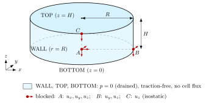

# Free-floating cylinder

Active poro-elastic gel cylinder ($R = 3$ mm, $H = 1.5$ mm) seeded with contractile cells (Hill chain) of random
isotropic orientation, floating in the medium: no clamp, drained ($p = 0$) and traction-free on its whole boundary.
Under the activation $\alpha(t)$ (ramp 0 → 1, then hold) the cells contract, the gel shrinks in every direction and
expels liquid; the cells may also migrate, proliferate and reorient.



Unknowns $\mathbf u, p, \varepsilon_a$, and optionally $\Phi_c, \tilde\phi_s$ (`cell_transport`) and $\theta, \varphi$
(`remodelling`); residuals and options: module docstring of `hill_cylinder_free.py`.

Rigid-body modes are removed by an isostatic (3-2-1) support at the mesh vertices nearest to three bottom points:

| Point | Location | Blocked |
| --- | --- | --- |
| $A$ | $(0, 0, 0)$ | $u_x, u_y, u_z$ |
| $B$ | $(R, 0, 0)$ | $u_y, u_z$ |
| $C$ | $(0, R, 0)$ | $u_z$ |

Six components for six rigid modes, none redundant: with no load the internal stress is self-equilibrated, the
reactions vanish and the solution is the free one (displacements relative to $A$).

| Item | Where |
| --- | --- |
| Hill law ($R_u$), activation $\alpha(t)$ | `materials.cell.active.hill`, `materials.cell.active.activation` |
| CE evolution ($R_a$) | `operators.cell.hill.ContractileEvolution` |
| Clipped proliferation | `operators.cell.SaturatedProliferation` |
| Scales ($L_0, \mu_0, t_0$), conversions | `scaling.CharacteristicScales` |
| $k(\phi_\ell)$, $\mathbf K_L = (k/\eta) J \mathbf C^{-1}$ | `materials.permeability` |
| Compaction volumetric energy | `materials.volumetric.compaction` |
| Orientation diagnostics | `materials.orientation.display` |
| Supports | `dolfin_mech.core.PinpointSubDomain` (pointwise BCs) |

| Demo file | Content |
| --- | --- |
| `hill_cylinder_free.py` | configuration (`UserInputs`), mesh, unknowns, laws, residuals, BCs, solve |
| `hill_cylinder_scaling.py` | SI inputs → dimensionless coefficients (`Coefficients`) |
| `hill_cylinder_outputs.py` | SI fields (XDMF) and QOIs (`.dat`) |
| `cylinder_post_processing.py` | orientation figures from the results |

The solve is dimensionless (by the parameters): $\hat{\mathbf X} = \mathbf X/L_0$ with the drainage length
$L_0 = H$, $\hat p = p/\mu_0$, $\hat t = t/t_0$, $t_0 = H^2\eta/(k\,\kappa_{gel}) \approx 880$ s with the default
parameters. Inputs and outputs are SI; the XDMF geometry and time stamps are put back in m and s after the run.

## Run

```bash
cd demos/hill_cylinder_free
python3 hill_cylinder_free.py             # or: mpirun -np 4 python3 hill_cylinder_free.py
python3 cylinder_post_processing.py       # [--results <xdmf>] [--output-dir <dir>] [--bins 36] [--sphere-bins 30]
```

## Outputs (`outputs_hill_cylinder_free/`, SI)

`results/` (`hill_cylinder_outputs.py`):

- point data: `displacement_si`, `pressure_si`;
- cell data: `jacobian`, `fluid_fraction`, `permeability_ratio`, `theta`, `phi`, `cell_fraction`, orientation
  angles (`theta_deg`, `phi_deg`, `theta_wrapped_deg`, `tilt_xy_deg`, `angle_x_deg` and `_current` variants),
  `lambda_*`, `tension_*`, `fibre`, `fibre_initial`, `fibre_current`, `cell_cauchy`, `total_cauchy`;
- QOIs: `time_si`, `cellular_activation`, `top_center_disp_z` at $(0, 0, H)$ (height change), `wall_disp_y` on
  the wall at mid-height, $(0, -R, H/2)$ inset by $h_{max}^2/(4R)$ (the polyhedral mesh lies inside the circle):
  $-\Delta R$ there, `center_pressure`, averages `mean_*` (`mean_jacobian` $= V/V_0$), `order_x`, `order_z`
  ($z$: axis of the cylinder), `mean_tilt_xy_deg`.

`post_processing/` (`cylinder_post_processing.py`, numpy, h5py, matplotlib): `orientation_histograms.png`,
`orientation_sphere.png` (seen from $+z$, along the axis), `orientation_time.png`.
