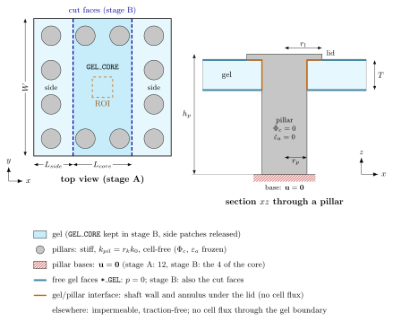

# Microtissue between pillars (biaxial, then uniaxial)

Active poro-elastic gel slab ($875 \times 875 \times 50\ \mu\text{m}$, three patches) seeded with contractile cells
(Hill chain) of random isotropic orientation, held by twelve mushroom-shaped micropillars clamped at their bases
(Mostert et al. 2026, `fenicsoft.mesh_geometries.microtissue_pillars`). Each pillar crosses the gel (shaft of
radius $r_p$) and carries a lid of radius $r_l$ **on top of the gel**, $z \in [T, T + t_l]$. Stage A: all twelve
pillars hold the gel (biaxial). Stage B: the side patches are released, the core patch stays on its four pillars
(uniaxial).

<p align="center">
  
</p>

Gel: unknowns $\mathbf u, p, \varepsilon_a$, optionally $\Phi_c, \tilde\phi_s$ (`cell_transport`) and
$\theta, \varphi$ (`remodelling`), Hill chain, poromechanics and cell transport. Pillars (`equations.tex`,
$\Omega_0^{pil}$): stiff Neo-Hooke + quadratic volumetric, permeability $r_k k_0$ (constant), cell-free:
$\Phi_c$ and $\varepsilon_a$ frozen by their rate term, $\int_{\Omega^{pil}} (x - x^n)/\Delta t\,\delta x$, so
$\Phi_c = 0$, $\lambda_a = 1$ and no cell flux crosses the interface (`equations.tex`, Remark `rem:pillar-pin`).
Residuals and options: module docstring of `pillars_biaxial.py`.

The solve is dimensionless (by the parameters) with $L_0 = T$ (gel thickness): $t_0 = T^2\eta/(k\,\kappa_{gel})
\approx 1$ s; the pillar moduli are divided by $\mu_0$. Inputs, outputs and checkpoints are SI.

| Demo file | Content |
| --- | --- |
| `pillars_biaxial.py` | stage A: configuration, mesh, gel/pillar model, BCs, solve, SI checkpoints (shared by the cut and stage B) |
| `pillars_scaling.py` | SI inputs → dimensionless coefficients (`Coefficients`, pillar moduli included) |
| `pillars_outputs.py` | SI fields (XDMF) and QOIs (`.dat`) |
| `pillars_cut_to_core.py` | serial: core submesh, tags of the cut faces, transfer of the checkpoints |
| `pillars_uniaxial_release.py` | stage B: core patch from the stage A state, cut faces drained |
| `pillars_post_processing.py` | orientation, $\Phi_c$ and $p$ in a central ROI or the whole gel |
| `batch_hill_microtissue_pillars.sh` | the four steps in Docker (asimov) |

| Library object | Use |
| --- | --- |
| `materials.domain_fields` | $\chi_{gel}$ (DG0) and $\chi^{int}_{pil}$ (CG1: initial $\Phi_c = 0$ strictly inside the pillars) |
| `materials.permeability`, `materials.volumetric.compaction`, `materials.cell.active.hill` | gel laws |
| `fenicsoft.operators.ChangeRate` | frozen $\Phi_c$, $\varepsilon_a$ in the pillars |
| `fenicsoft.io` (`extract_submesh_by_tags`, `project_facet_tags`, `transfer_*`, checkpoints) | cut and hand-over |

## Run

```bash
cd demos/hill_microtissue_pillars
mpirun -np 8 python3 pillars_biaxial.py            # stage A
python3 pillars_cut_to_core.py                     # serial
mpirun -np 8 python3 pillars_uniaxial_release.py   # stage B
python3 pillars_post_processing.py --stage a       # [--stage b] [--whole-domain] [--roi-side-um 130]
```

or the whole pipeline in Docker (logs in `logs/pipeline_pillars/`):

```bash
nohup ./batch_hill_microtissue_pillars.sh > pipeline_pillars.log 2>&1 &
```

The batch mounts the whole playground (`PYTHONPATH=/app/src` for `hill_playground`); the image (`fenicsoft:latest`)
must hold the fenicsoft branch with `scale_factor` and `OrientationChange`, and the restructured `dolfin_mech`.

## Outputs (SI)

`outputs_pillars_biaxial/` (stage A) and `outputs_pillars_uniaxial_release/` (stage B; its `mesh/` folder holds the
cut):

- `results/` (`pillars_outputs.py`): `displacement_si`, `pressure_si` (point data); `jacobian`, `fluid_fraction`,
  `permeability_ratio` (gel law), orientation angles, `lambda_*`, `tension_*`, `fibre*`, `cell_cauchy`,
  `total_cauchy` (gel or pillar law), `gel_indicator` (cell data); QOIs on the core patch (centre, top-face centre,
  front face) and averages over the gel. Hill fields are meaningful in the gel only.
- `results/<field>.xdmf`: SI checkpoints $\mathbf u, p, \Phi_c, \theta, \varphi, \varepsilon_a$ (stage A → cut →
  stage B).
- `post_processing_roi/`, `post_processing_gel/`: orientation histograms, equal-area projection and time history
  restricted to the region, and `phi_pressure_time.png` (mean, min–max of $\Phi_c$ and $p$).
